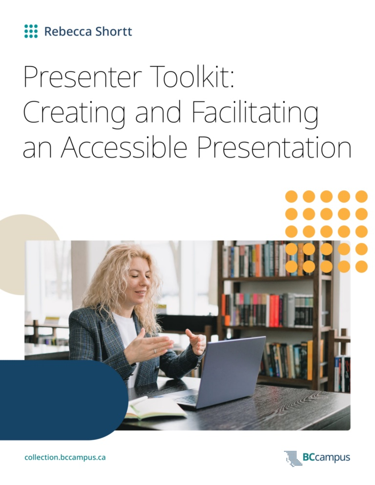

# Presenter Toolkit

Creating and Facilitating an Accessible Presentation

Rebecca Shortt

[CC BY 4.0](https://creativecommons.org/licenses/by/4.0/ ":class=navpill")

[Start Reading](section-2/README.md ":class=button :class=primary")

> [!IMPORTANT]
> **Presenter Toolkit – Imported from Pressbooks**
>
>
> **Authors:** Rebecca Shortt | **License:** CC BY 4.0 | **5 pages**
>
> [View original on Pressbooks](https://opentextbc.ca/presentertoolkit/)
>
>

The Presenter Toolkit was created to support presenters in creating accessible and inclusive online and in-person presentations.

## [Presenting Practices](section-2/README.md) <!-- {docsify-ignore} -->

## [Slide Design](section-3/README.md) <!-- {docsify-ignore} -->

## [Virtual Presenting Tips](section-4/README.md) <!-- {docsify-ignore} -->

## [Back Matter](section-5/more-resources.md) <!-- {docsify-ignore} -->

Appendices, bibliography, and versioning history.

**[Start Reading →](section-2/README.md)**

Presenter Toolkit by Rebecca Shortt is licensed under <a href="https://creativecommons.org/licenses/by/4.0/">CC BY 4.0</a>.

<!-- Hides the sidebar on this page -->

